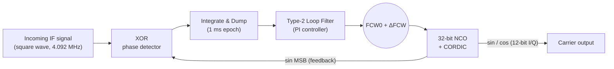

# FPGA Implementation of an All-Digital PLL for GPS L1 (1575.42 MHz)

An **All-Digital Phase-Locked Loop (ADPLL)** written in VHDL and modelled in MATLAB, designed to track a GPS L1 carrier after downconversion to a 4.092 MHz intermediate frequency. Every block of a classic analog PLL is replaced with synthesizable digital logic: an XOR phase detector with integrate-and-dump, a Type-2 PI loop filter, and a 32-bit NCO with a pipelined CORDIC sine/cosine generator.

Target platform: **Zynq-7020 SoC + AD9361 RF transceiver (SDR)**.

> Developed during a summer internship (May–July 2026) at the Directorate of Special Projects, DRDO.

---

## Highlights

- Fully digital, multiplier-free waveform generation (16-stage CORDIC, shift-and-add only)
- Type-2 (proportional-integral) loop filter, giving zero steady-state phase error for a constant frequency offset
- Loop coefficients derived from loop bandwidth and damping ratio in MATLAB, then quantized to fixed point for VHDL
- Clocking chosen around the GPS C/A code: 16.368 MHz = 16 × 1.023 Mcps, so one 1 ms code epoch is exactly 16,368 clock cycles
- MATLAB model locks onto a 50 Hz offset in about 30 ms with ~0 residual frequency and phase error

---

## Architecture



### 1. Phase detector (`phase_detector_id2`)
The reference and NCO feedback (the sign bit of the NCO sine output) are registered and XORed on every clock. An integrate-and-dump accumulator counts the XOR `1`s over a 16,368-sample epoch and outputs the signed deviation from the midpoint (`EPOCH_LEN/2`), which corresponds to quadrature (90°) lock. An `update_en` pulse marks each new error sample.

### 2. Loop filter (`loop_filter1`)
A digital version of the R1–R2–C Type-2 filter:

```
integrator[n] = integrator[n-1] + C2 · error[n]
output[n]     = C1 · error[n]   + integrator[n]
```

Derived with a forward-Euler approximation of $F(s) = \frac{R_2}{R_1} + \frac{1}{sR_1C}$, giving $C_1 = R_2/R_1$ and $C_2 = T_s/(R_1C)$. Coefficients are stored as integers scaled by $2^{30}$, and the integrator has extra headroom bits to avoid overflow during acquisition.

### 3. NCO + CORDIC (`nco_cordic1`)
A 32-bit phase accumulator adds `FCW0 + ΔFCW` every clock:

$$f_{out} = \frac{FCW \cdot f_s}{2^{32}}$$

The top two phase bits select the quadrant, and the remaining 30 bits drive a 16-stage pipelined CORDIC in rotation mode (15-bit internal width with 3 guard bits, gain pre-compensated by 0.60725). Outputs are 12-bit signed sine and cosine.

### 4. Top level (`adpll_top`)
Connects the three blocks, adds the filter correction to the centre FCW, and registers the sine, cosine, and phase-error outputs. It also exposes `fcw_corr_out` for diagnostics and `fb_clk_out` for the AD9361 interface.

---

## Design parameters

| Parameter | Value | Notes |
|---|---|---|
| RF carrier | 1575.42 MHz | GPS L1 (reference only) |
| IF | 4.092 MHz | 4 × C/A chip rate |
| Sample / system clock | 16.368 MHz | 4 × IF, 16 × 1.023 Mcps |
| Samples per epoch | 16,368 | 1 ms loop update |
| Loop bandwidth $B_L$ | 50 Hz | |
| Damping ratio $\zeta$ | 0.707 | |
| Natural frequency | 15.006 Hz (94.29 rad/s) | from $B_L = \frac{\omega_n}{2}(\zeta + \frac{1}{4\zeta})$ |
| $C_1$ (proportional) | 0.23344209 | fixed: `250656535` |
| $C_2$ (integral) | 0.03113188 | fixed: `33427601` |
| Fixed-point scaling | $2^{30}$ | `round(C × 2^30)` |
| NCO width | 32 bits | |
| Centre FCW (`FCW0`) | 1073741824 (`0x40000000`) | = $2^{30}$, i.e. 4 clocks per IF cycle |
| NCO resolution | 0.003811 Hz | $f_s / 2^{32}$ |

The digital PI coefficients use the standard GPS-receiver form:

$$C_1 = \frac{4\zeta\omega_nT}{1 + 2\zeta\omega_nT + (\omega_nT)^2}, \qquad C_2 = \frac{4(\omega_nT)^2}{1 + 2\zeta\omega_nT + (\omega_nT)^2}$$

---

## Results

### MATLAB model (400 ms, 50 Hz frequency offset)

| Metric | Result |
|---|---|
| Lock acquired | ~30 ms |
| Final frequency error | ≈ 0 Hz |
| Final phase error | ≈ 0° |
| Peak phase-error overshoot | ~50° |

The script plots nine panels: input, NCO output, raw XOR output, phase error, XOR average, integrator state, NCO frequency, frequency error (log scale), and a rolling-σ lock indicator.

### VHDL behavioral simulation (Vivado)

- `fcw_corr` settles to a steady correction of about **951** FCW steps to absorb the frequency offset
- `phase_error` and `fcw_corr` flatten into steady state at roughly **200 ms** of simulated time
- `sin_out` / `cos_out` produce continuous, synchronized 12-bit I/Q samples

<!-- Add your plots here, e.g.:


-->

---

## Repository structure

```
.
├── rtl/
│   ├── phase_detector_id2.vhd   # XOR PD + integrate-and-dump
│   ├── loop_filter1.vhd         # Type-2 PI loop filter
│   ├── nco_cordic1.vhd          # 32-bit NCO + 16-stage CORDIC
│   └── adpll_top.vhd            # Structural top level
├── sim/
│   └── tb_adpll_top.vhd         # Top-level testbench
├── matlab/
│   └── adpll_sim.m              # Loop design + epoch-level simulation
├── constraints/
│   └── adpll.xdc                # Zynq-7020 pin/clock constraints
└── docs/
    └── report.pdf               # Internship report
```

---

## Getting started

### MATLAB
```matlab
cd matlab
adpll_sim
```
This prints the loop parameters and the VHDL constants (`FCW0`, `C1_fixed`, `C2_fixed`, `EPOCH_LEN`) and opens the analysis figure. Change `B_L`, `zeta`, or `f_offset` at the top of the script to redesign the loop.

### Vivado
1. Create a new RTL project and add everything in `rtl/` as design sources.
2. Add `sim/tb_adpll_top.vhd` as a simulation source and set it as the simulation top.
3. Run behavioral simulation for several hundred ms (e.g. `run 500 ms`) to see acquisition and lock.
4. Add `constraints/adpll.xdc` and run synthesis and implementation for the Zynq-7020 (`xc7z020`).

The testbench drives a 16.368 MHz system clock and a 4.092 MHz reference square wave, then steps the reference frequency at 25 ms to check re-acquisition.

---

## Known limitations

- **No frequency detection.** A plain XOR detector cannot sense frequency, so pull-in depends on the loop filter and a limited capture range.
- **Duty cycle sensitivity.** The XOR detector assumes 50% duty cycle on both inputs; any asymmetry becomes a static phase offset.
- **Harmonic false lock.** XOR mixing produces odd-harmonic products, so an NCO started near a harmonic or sub-harmonic can lock to the wrong frequency.
- **Pipeline latency.** The 16-stage CORDIC adds delay inside the loop, which slows early acquisition.
- **Integrator wind-up.** A large initial offset can build up a big integrator value before the NCO catches up.
- **Idealized MATLAB loop.** The MATLAB model closes the loop on the ideal wrapped phase error; the XOR average is computed and plotted alongside it for comparison, while the VHDL uses the XOR/accumulator error directly.
- **No data modulation.** The input is an unmodulated square wave. Real GPS L1 C/A is BPSK, and its 180° navigation-bit flips would break lock for this detector.

---

## References

1. Texas Instruments, *Introduction to Phase-Locked Loop System Modeling*, SLYT169, 2004. https://www.ti.com/lit/pdf/slyt169
2. Analog Devices, *Fundamentals of Phase Locked Loops (PLLs)*, Tutorial MT-086, 2009. https://www.analog.com/media/en/training-seminars/tutorials/MT-086.pdf
3. E. D. Kaplan and C. J. Hegarty, *Understanding GPS/GNSS: Principles and Applications*, 3rd ed., Artech House, 2017.
4. R. E. Best, *Phase-Locked Loops: Design, Simulation, and Applications*, 6th ed., McGraw-Hill, 2007.
5. R. C. Dorf (Ed.), *The Electrical Engineering Handbook*, 3rd ed., CRC Press, 2006.
6. W. Tomasi, *Electronic Communications Systems: Fundamentals Through Advanced*, 5th ed., Pearson, 2004.

---

## Author

**Kandla Jha**
B.E. Electrical & Electronics Engineering + M.Sc. Physics, BITS Pilani K K Birla Goa Campus (2023–2028)

